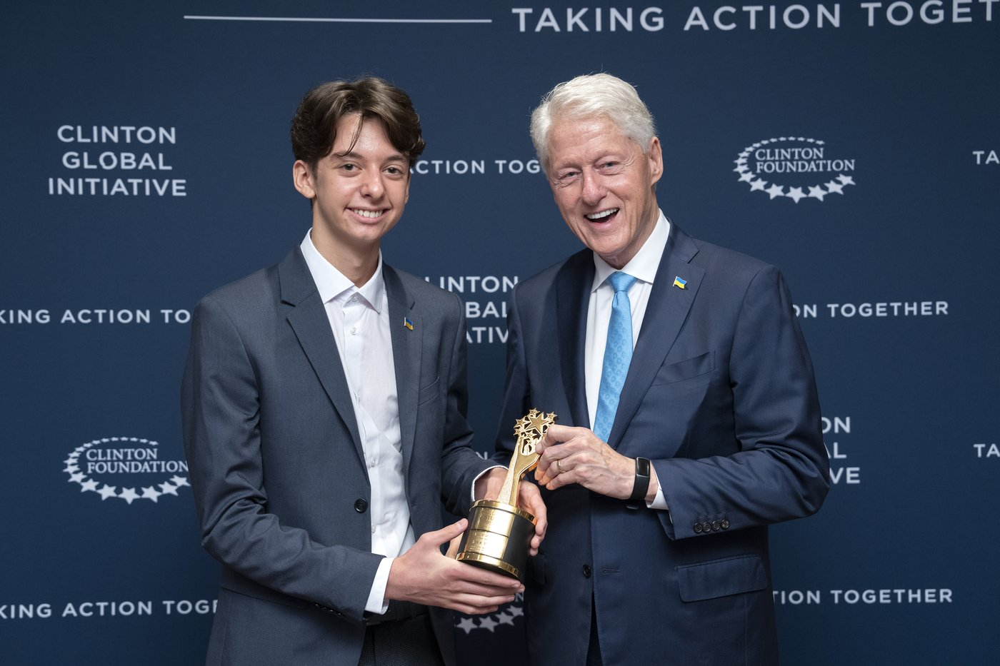
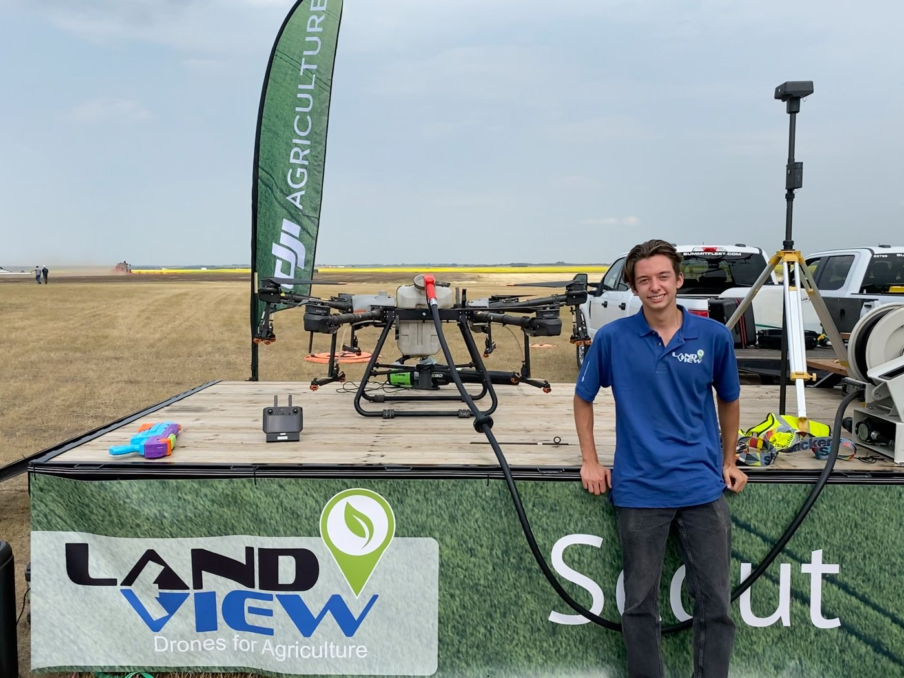
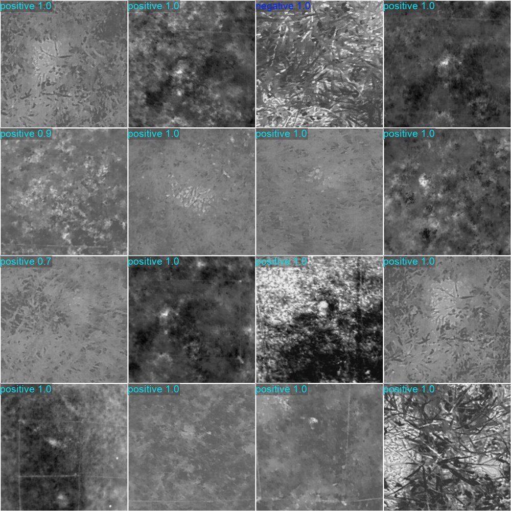
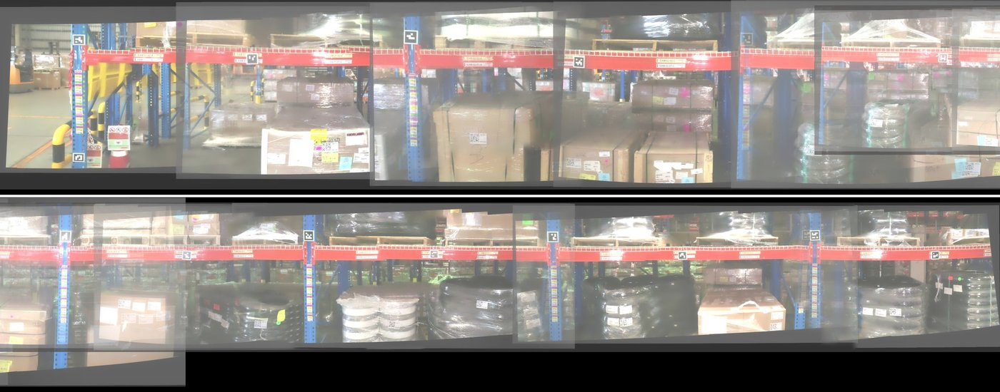
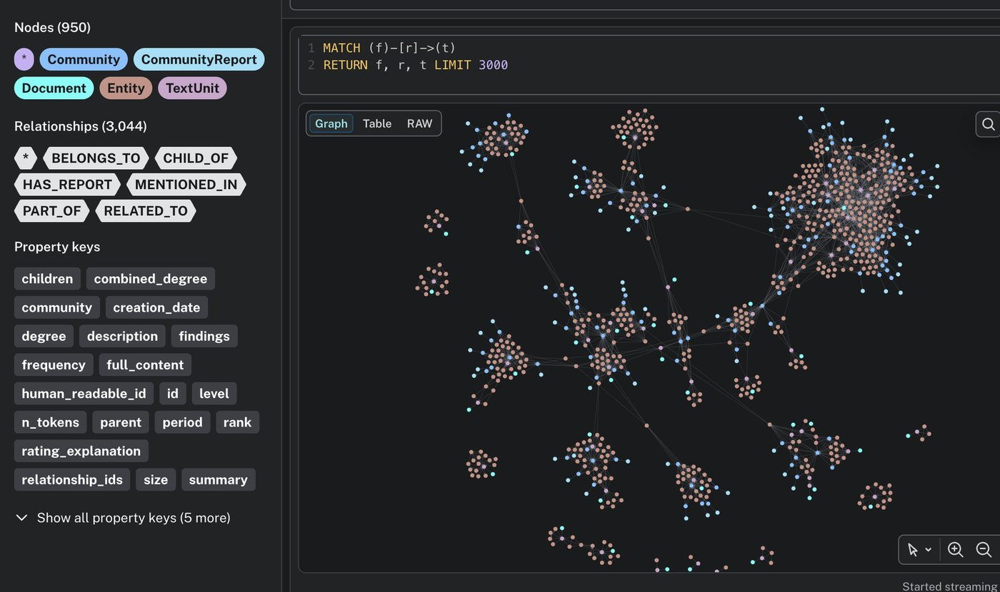
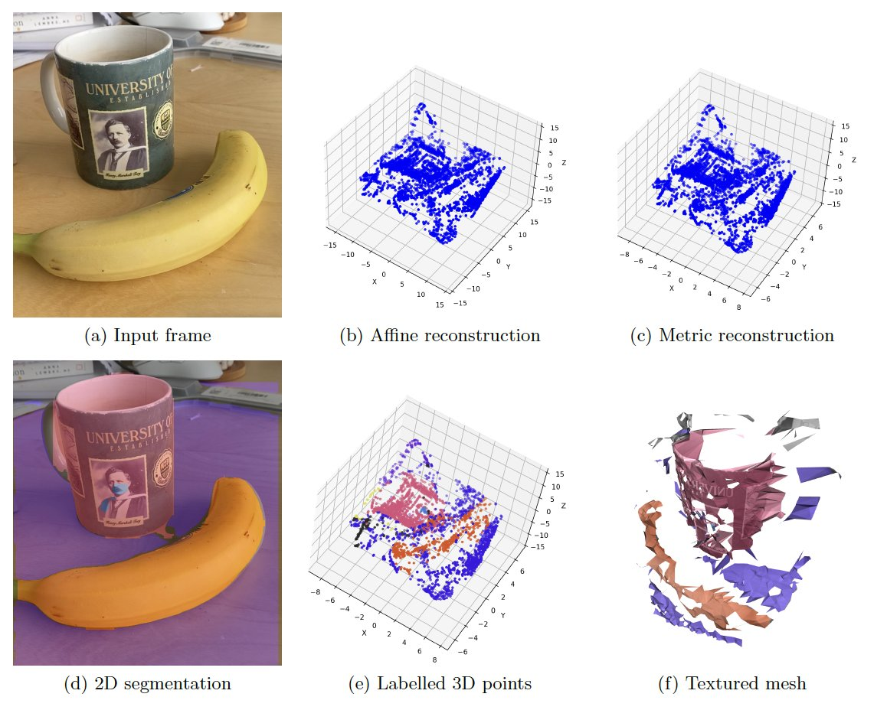

# Igor Klymenko

I build things that have to work outside, in a field, with people waiting on the result.

*Left: New York, September 2022. The [Global Student Prize](https://globalteacherprize.org/pages/igor-klymenko-2022) for a drone that finds landmines. Right: the drones I flew to calibrate satellites, at an ag show.*

## shipped

- A drone that finds landmines. Two Ukrainian patents, two working prototypes, a [WEF video](https://www.weforum.org/videos/award-winning-ukrainian-teenager-invents-landmine-detecting-drone), a talk at [SXSW EDU](https://schedule.sxswedu.com/2023/events/PP129251). Started in high school in Kyiv.
- Then the same job from the air with a CNN: [95.9% on thermal frames it had never seen](https://github.com/IgorKlymenko/drone-thermal-landmine-detection), over real test minefields. University of Sydney.
- [Loupe](https://loupe-eight.vercel.app/), a search engine for VCs. 150 users in the first week and a $250K pre-seed from a fund in San Francisco.
- [A search engine over Slack](https://github.com/IgorKlymenko/graph-based-search-engine) that links every mention into an entity graph and answers with citations. An agent using it as a tool got 69% of questions right against 48% with grep.
- [Drone video in, measured warehouse aisles out](https://github.com/IgorKlymenko/drone-warehouse-mapping). The alternative was me with a tape measure in the Thai heat.
- [A 14-joint robot arm steered from a game controller](https://github.com/IgorKlymenko/robot-joystick-from-foundation-model) and [phone video to a labelled 3D scene](https://github.com/IgorKlymenko/video-to-labeled-3d), both at the University of Alberta.

   

## now

Starting the neolab: an implant that makes thinking faster and belongs to the person it's in. Looking for a grant or fellowship to fund a year of work toward the first prototype.

Toronto. kklymenkk@gmail.com, [igorklymenko.com](https://www.igorklymenko.com/), [LinkedIn](https://www.linkedin.com/in/kkymenko/).
